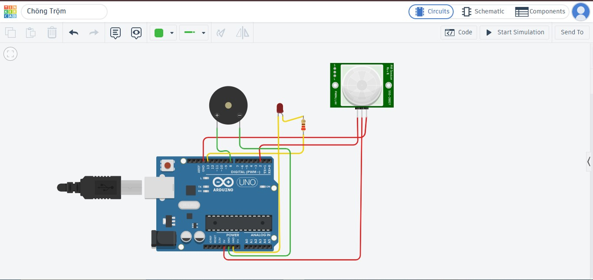

# Mô hình chống trộm Arduino

Mô hình chống trộm mô phỏng trên Tinkercad, dùng Arduino Uno để phát hiện
chuyển động và kích hoạt còi, đèn báo động.

## Link thiết kế Tinkercad
https://www.tinkercad.com/things/7dlm4zVyjRU-chng-trm?sharecode=TaFs33_5gWnSnod--eyWXER7Ux9B72m3LJHUyXOkm7s

## Linh kiện
- Arduino Uno
- Cảm biến chuyển động PIR
- Còi buzzer
- Đèn LED, điện trở

## Cách chạy mô phỏng
1. Mở link Tinkercad ở trên và bấm Simulate để chạy thử.
2. Muốn chỉnh sửa, đăng nhập tài khoản Tinkercad (miễn phí) rồi bấm Tinker this để tạo bản sao riêng.
3. Kích hoạt cảm biến PIR để xem còi và đèn LED báo động.

## Sơ đồ mạch

## Nguyên lý hoạt động
Cảm biến PIR phát hiện chuyển động thì Arduino bật còi và đèn LED, hết chuyển động thì tắt.

## ## Phần tác giả thực hiện
- Thiết kế sơ đồ mạch trên Tinkercad
- Viết mã nguồn Arduino (chong_trom.ino)
## Đóng góp
Mọi người có thể fork dự án hoặc gửi Pull Request/Issue để góp ý.

## Giấy phép
MIT License, thiết kế Tinkercad theo CC-BY 3.0.
